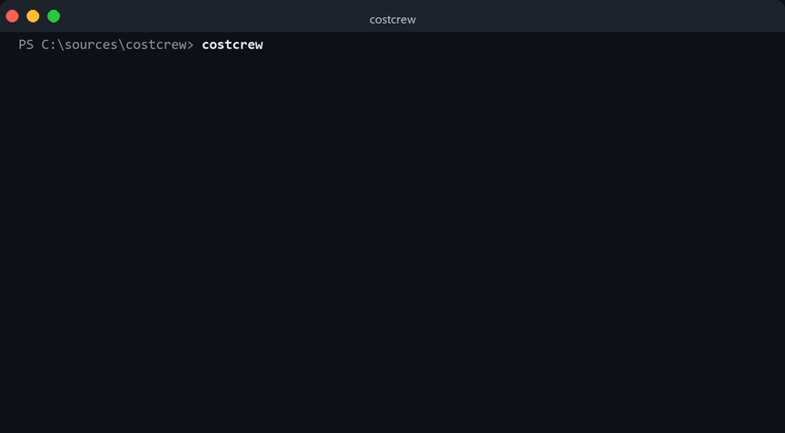
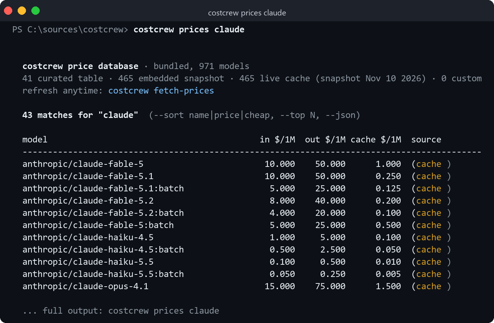
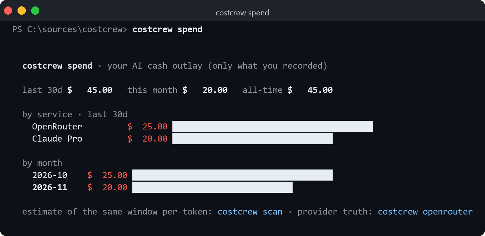

# costcrew

**The AI coding price database — plus what *you* spend on it.**

One binary, two halves. First: a bundled database of what every model costs —
every input/output/cache rate per 1M tokens, works offline, no API key, no
scanning, nothing to configure. Second: your own spend — recorded by you,
totaled by month and service, plus provider-reported truth from your API keys.

<p align="center">
  
</p>

Type `costcrew` and you get the app above: coin mascot spins while the price
database loads, the banner cascades in with a gradient shimmer, the subtitle
types itself out, and the menu cascades in. Arrow keys + enter; all the
classic one-shot flags still work for scripting (`costcrew scan --json`, etc.).

## The price database

`data/prices.json` ships **inside the binary** — a full OpenRouter catalog
snapshot (465 models, refreshed monthly by CI and committed to the repo) merged
with a curated vendor table. Ask it anything:

```sh
costcrew prices               # the whole database
costcrew prices claude        # filter by name
costcrew prices --sort cheap  # cheapest first (name | price | cheap)
costcrew prices --json        # machine-readable
```

<p align="center">
  
</p>

Rules the database lives by:

- **No invented prices.** A free/unpriced model shows `?` and is excluded from
  totals. Unknown stays unknown.
- **Precedence is explicit** — curated table → embedded snapshot → on-disk
  cache → your `--prices` overrides. Later sources win ties, so a fresh
  `costcrew fetch-prices` beats the bundled snapshot, and your overrides beat
  everything.
- **It refreshes itself** — `costcrew fetch-prices` pulls all ~465 live
  OpenRouter models (public endpoint, no key), and CI re-commits a fresh
  snapshot monthly so source builds never go stale.
- **`per_hour` for rented GPUs** — bill wall-clock for self-hosted inference
  (see overrides below).

## Your spend on AI

The database tells you prices; this tells you what **you** paid. You record the
money that actually left your account — subscriptions, credit top-ups, GPU
rentals — and costcrew totals it by month and service:

```sh
costcrew spend                              # the ledger summary
costcrew spend add 20 --service "Claude Pro"
costcrew spend add 25 --service "OpenRouter" --note "credit top-up"
costcrew spend add 1.84 --service "Vast.ai" --model llama-70b --note "2h @ $0.92/h"
```

<p align="center">
  
</p>

The ledger is a plain JSON file in `%LOCALAPPDATA%\costcrew` — nothing is
telemetered, nothing leaves your disk. Three views of money, deliberately
separate:

| view | source | meaning |
|---|---|---|
| `costcrew spend` | you record it | what actually left your bank account |
| `costcrew openrouter` | your API key | provider-reported, per-model truth |
| `costcrew scan` | local logs (optional) | per-token *estimate* of your usage |

## Install

```sh
# macOS / Linux (curl)
curl -fsSL https://raw.githubusercontent.com/Arch087146/costcrew/main/install.sh | sh

# Windows (PowerShell)
powershell -c "irm https://raw.githubusercontent.com/Arch087146/costcrew/main/install.ps1 | iex"

# Homebrew
brew install Arch087146/tap/costcrew

# npm (prebuilt binary — no compile step)
npm install -g @archeagle087/costcrew

# winget (Windows)
winget install Arch087146.costcrew

# from source (Rust 1.80+)
git clone https://github.com/Arch087146/costcrew
cargo install --path costcrew
```

Prebuilt binaries also land on the [Releases](https://github.com/Arch087146/costcrew/releases)
page when a tag is pushed. No runtime dependencies — the database travels with
the binary.

## Usage

```sh
costcrew                     # the interactive app (splash + arrow-key menu)
costcrew prices claude       # browse the database, filtered
costcrew spend               # your recorded payments, totaled
costcrew leaderboard         # arena Elo, priced — elo-per-dollar value sort
costcrew budget 20           # best model for $20/month (asks your tasks)
costcrew catalog             # which agent ships with which models
costcrew scan --since 7d     # optional: estimate from local agent logs
costcrew md > spend.md       # shareable markdown report
costcrew --json              # machine-readable, pipe anywhere
```

And `--help`, for people who judge CLIs by their help text:

<p align="center">
  
</p>

## Optional: estimate from local agent logs

If you *also* want a per-token estimate of what you used — independent of how
you pay — `costcrew scan` reads local logs, read-only:

| Tool | Source | Status |
|---|---|---|
| OpenCode | `opencode.db` (SQLite message table, legacy JSON storage) | ✅ |
| Claude Code | `~/.claude/**/*.jsonl` transcripts | ✅ |
| Kilo Code | VS Code globalStorage task logs | ✅ best-effort |
| Cline | VS Code globalStorage task logs (incl. agent-reported costs) | ✅ best-effort |
| Roo Code | VS Code globalStorage task logs | ✅ best-effort |
| Aider | cost lines in `~/.aider*.history.md` | ✅ |
| Codex CLI | `~/.codex/sessions` JSONL | ✅ best-effort |
| Gemini CLI, Cursor, Windsurf, Copilot | — | roadmap |

Everything is read **read-only** — the SQLite connection is opened `READ_ONLY`, and
no log file is ever touched. Here it is five minutes after `cargo install`, reading
a real OpenCode database — note it found 285 requests for a model it has no price
for and *didn't bill the unknown model* instead of making a number up:

<p align="center">
  
</p>

## Should you have used a cheaper model?

`costcrew advise` recomputes your **actual token mix** (input/out/cache ratios
included) on every comparable model at the same or better benchmark tier, and
flags probable waste — today's most common answer is "carrier-tier sticker shock":

<p align="center">
  
</p>

It's a heuristic — quality tiers come from public coding evals, and it refuses to
suggest a downgrade it can't back with your own measured spend. The last line is
baked in: "run one task as an A/B and compare before rewiring your whole
workflow."

## Subscriptions: the price displayed is list price

One honest caveat up front: if your agent runs on a **subscription** (Claude Code
Pro/Max, Cursor Pro, Copilot), those tokens cost you *zero marginal dollars* —
costcrew still shows what the same usage would have billed per-token, because
that's the common denominator across every tool it scans. Read subscription
values as "what this session would cost at list price," not "what you'll owe."

API keys, OpenRouter credits, and rented GPUs do map 1:1 to dollars, which is
where the totals get literal.

## Is the leaderboard crown worth its price?

`costcrew leaderboard` answers what arena.ai can't: quality **and** the bill.
Arena Elo from ~2M blind votes, priced three ways — raw in/out $, an
`agent$` blend realistic for coding agents (20% input, 10% output,
**70% cache-read** — cache dwarfs everything in agentic loops), and
**elo/$** value points per dollar:

```sh
costcrew leaderboard                  # default: by Elo
costcrew leaderboard --sort value     # what a cheapskate should actually run
costcrew leaderboard --sort price
costcrew leaderboard --top 50 --json
```

<p align="center">
  
</p>

One caveat, stated plainly: the Elo snapshot is bundled with the binary and
dated, like the prices — trust it within ±their margin of error (±4–19 pts),
trust the prices within vendor-whim.

## Which agent runs on what?

`costcrew catalog` prints the lay of the land — every coding agent's billing
model (subscription vs BYOK vs free tier), its model menu, and whether costcrew
can read its logs:

<p align="center">
  
</p>

## Pricing

Prices live in two places: the curated table in
[`src/price.rs`](src/price.rs) and the embedded catalog
[`data/prices.json`](data/prices.json) (committed monthly from OpenRouter's
public endpoint). Lookup is plain prefix-match, longest prefix wins, so
`claude-opus-4-5-20260115` matches `claude-opus-4`. Costs are approximate list
prices (no discounts, no pro-plan pooling) and drift — treat the totals as
≥85% accurate.

Missing your model? Add one line and PR it. Cache reads/writes are priced
separately where the API exposes them, otherwise the bucket is collapsed.

For anything else — private models, rented GPUs — override with `--prices`:

```json
{
  "prices": [
    { "prefix": "big-pickle", "input": 0.25, "output": 0.95, "cache_read": 0.13 },
    { "prefix": "local/qwen3-32b", "per_hour": 2.19 }
  ]
}
```

`per_hour` is how you bill **rented GPUs / self-hosted inference** — costcrew
computes wall-clock per request from OpenCode's session timestamps (hourly rate ×
time actually spent) and adds it to the token bill.

## Why a CLI and not a dashboard?

Because the dashboard already exists — inside each vendor's billing page — and
it'll tell you nothing about the model you ran through a different tool yesterday.
costcrew is one screen, one binary, and it works the same whether the spend came
from Claude Code, OpenCode, or whatever ships next week.

It's open source too, so "how much did I spend on agents last month" and
"show me the math" live in the same place.

## Contributing

Spotted a tool whose logs we don't parse? The scanner is intentionally dumb —
`src/scan.rs` walks a handful of roots, parses any JSON/JSONL that smells like
`modelID` + token counts, and sqLite for the rest.

- `cargo test` — unit tests for aggregation and pricing
- `cargo clippy`-clean; fmt-checked in CI

## License

MIT — see [LICENSE](LICENSE).
