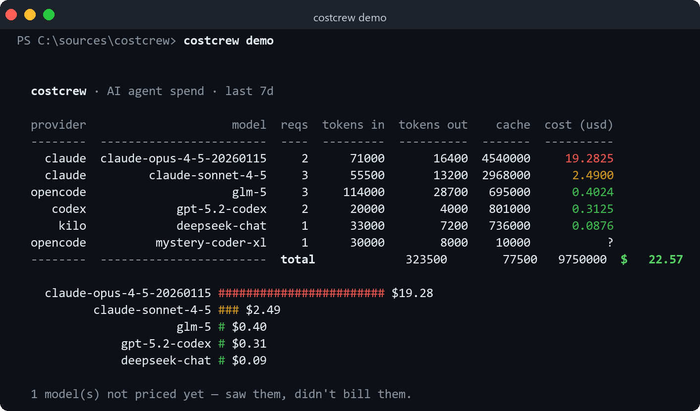
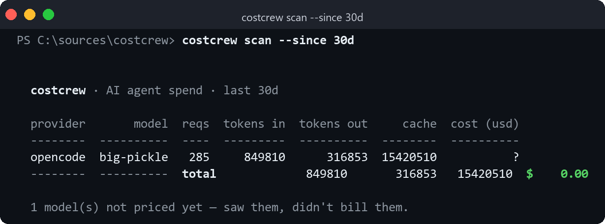
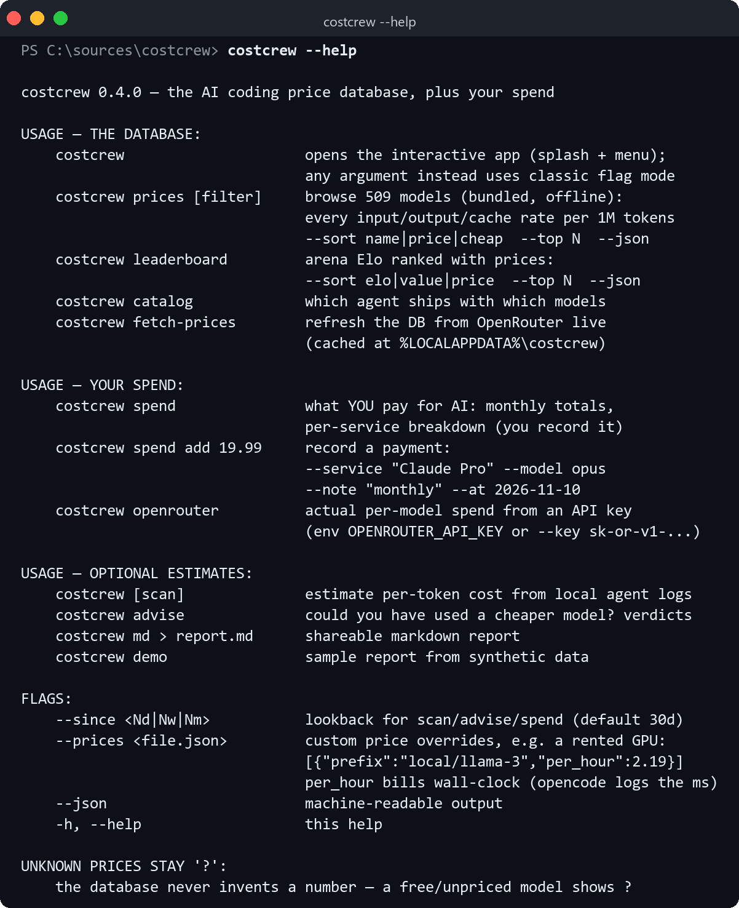
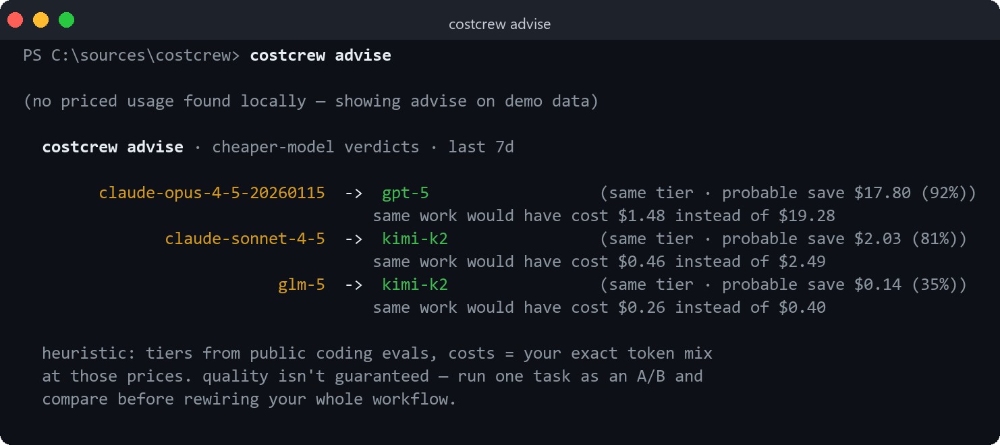
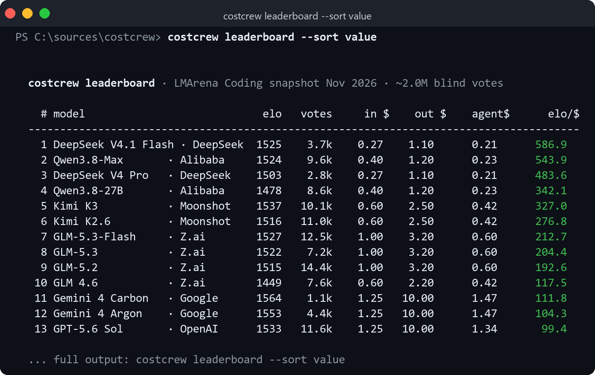
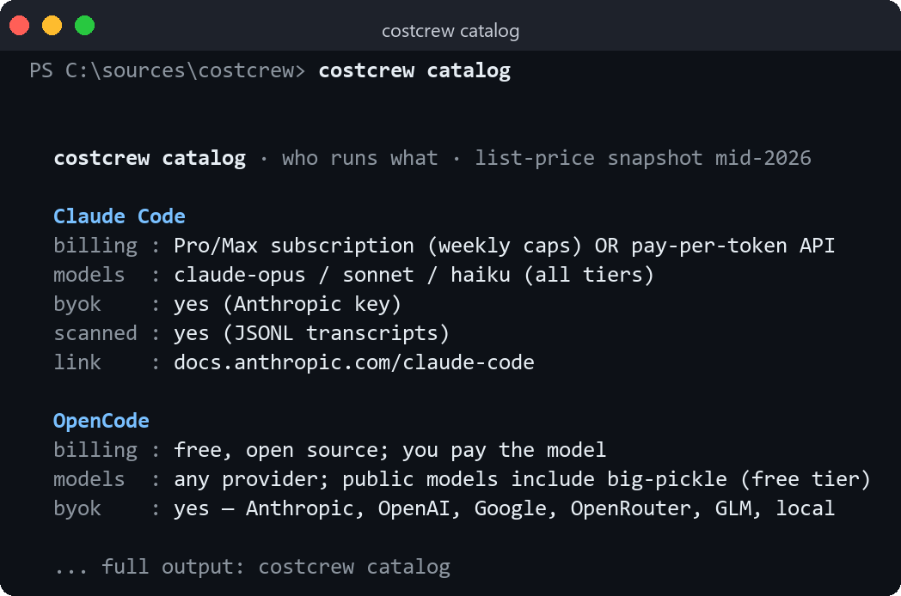

# costcrew

**Find out what your AI coding agents *actually* cost you.**

Desktop dashboards hide it behind your subscription. costcrew reads the usage logs
already sitting on your machine, applies per-model prices, and prints the bill —
per model, in dollars, right in your terminal.

<p align="center">
  
</p>

That "mystery-coder-xl" row is deliberate: when costcrew doesn't recognize a model,
it shows what it found but refuses to invent a price.

## What it reads

| Tool | Source | Status |
|---|---|---|
| OpenCode | `opencode.db` (SQLite message table, legacy JSON storage) | ✅ |
| Claude Code | `~/.claude/**/*.jsonl` transcripts | ✅ |
| Kilo Code | VS Code globalStorage task logs | ✅ best-effort |
| Cline | VS Code globalStorage task logs (incl. agent-reported costs) | ✅ best-effort |
| Roo Code | VS Code globalStorage task logs | ✅ best-effort |
| Aider | cost lines in `~/.aider*.history.md` | ✅ |
| Codex CLI | `~/.codex/sessions` JSONL | ✅ best-effort |
| Gemini CLI, Cursor, Windsurf, Copilot | — | roadmap |

Everything is read **read-only** — the SQLite connection is opened `READ_ONLY`, and
no log file is ever touched. costcrew only ever reads files newer than `--since`.

Here it is five minutes after `cargo install`, reading a real OpenCode database —
note it found 285 requests for a model it has no price for and *didn't bill the
unknown model* instead of making a number up:

<p align="center">
  
</p>

## Install

```sh
# from source (Rust 1.80+)
git clone https://github.com/Arch087146/costcrew
cargo install --path costcrew
```

Prebuilt binaries land on the [Releases](https://github.com/Arch087146/costcrew/releases)
page when a tag is pushed. No runtime dependencies — everything's read from disk.

## Usage

```sh
costcrew                 # scan your machine, default lookback 30 days
costcrew --since 7d      # this week's damage
costcrew md > spend.md   # shareable markdown table (great for standups or gists)
costcrew --json          # machine-readable — pipe into a cron, a webhook, whatever
costcrew demo            # sample report from synthetic data, no scanning needed
```

And `--help`, for people who judge CLIs by their help text:

<p align="center">
  
</p>

## Price EVERYTHING: subscriptions, API keys, and rented GPUs

Three pricing sources, merged, longest-prefix wins:

1. **Built-in table** (`src/price.rs`) — curated list prices for Claude, OpenAI,
   Google, GLM/Zhipu, DeepSeek, Qwen, Kimi, Grok, Llama, Mistral, MiniMax, Cohere
   and friends. OpenRouter-style slugs (`anthropic/claude-...`) match too.
2. **Live OpenRouter list** — `costcrew fetch-prices` pulls **all ~465 OpenRouter
   models** (including `:free` tiers) and caches them in
   `%LOCALAPPDATA%\costcrew`. Every later scan prices against them automatically.
   No API key needed — it's a public endpoint.
3. **Your own overrides** — `--prices prices.json` for anything else:

```json
{
  "prices": [
    { "prefix": "big-pickle", "input": 0.25, "output": 0.95, "cache_read": 0.13 },
    { "prefix": "local/qwen3-32b", "per_hour": 2.19 }
  ]
}
```

`per_hour` is how you bill **rented GPUs / self-hosted inference** — costcrew
computes wall-clock per request from OpenCode's session timestamps (hourly rate ×
time actually spent) and adds it to the token bill.
Local models with no price are shown with `?` and excluded from totals — never
invented.

### Paying by API key instead of a subscription?

`costcrew openrouter` (with `OPENROUTER_API_KEY` set, or `--key`) asks OpenRouter
how much each model actually cost on your key — provider-reported truth, per
model, not an estimate.

## Should you have used a cheaper model?

`costcrew advise` recomputes your **actual token mix** (input/out/cache ratios
included) on every comparable model at the same or better benchmark tier, and
flags probable waste — today's most common answer is "carrier-tier sticker shock":

<p align="center">
  
</p>

It's a heuristic — quality tiers come from public coding evals, and it refuses to
suggest a downgrade it can't back with your own measured spend. The last line is
baked in: "run one task as an A/B and compare before rewiring your whole
workflow."

## Is the leaderboard crown worth its price?

`costcrew leaderboard` answers what arena.ai can't: quality **and** the bill.
Arena Elo from ~2M blind votes, priced three ways — raw in/out $, an
`agent$` blend realistic for coding agents (20% input, 10% output,
**70% cache-read** — cache dwarfs everything in agentic loops), and
**elo/$** value points per dollar:

```sh
costcrew leaderboard                  # default: by Elo
costcrew leaderboard --sort value     # what a cheapskate should actually run
costcrew leaderboard --sort price
costcrew leaderboard --top 50 --json
```

<p align="center">
  
</p>

One caveat, stated plainly: the Elo snapshot is bundled with the binary and
dated, like the prices — trust it within ±their margin of error (±4–19 pts),
trust the prices within vendor-whim.

## Which agent runs on what?

`costcrew catalog` prints the lay of the land — every coding agent's billing
model (subscription vs BYOK vs free tier), its model menu, and whether costcrew
can read its logs:

<p align="center">
  
</p>

## Pricing

Prices live in [`src/price.rs`](src/price.rs) — a plain prefix-match table, longest
prefix wins, so `claude-opus-4-5-20260115` matches `claude-opus-4`. Costs are
approximate list prices (no discounts, no pro-plan pooling) and drift — treat the
totals as ≥85% accurate.

Missing your model? Add one line and PR it. Cache reads/writes are priced
separately where the API exposes them, otherwise the bucket is collapsed.

## Why a CLI and not a dashboard?

Because the dashboard already exists — inside each vendor's billing page — and
it'll tell you nothing about the model you ran through a different tool yesterday.
costcrew is one screen, one binary, and it works the same whether the spend came
from Claude Code, OpenCode, or whatever ships next week.

It's open source too, so "how much did I spend on agents last month" and
"show me the math" live in the same place.

## Contributing

Spotted a tool whose logs we don't parse? The scanner is intentionally dumb —
`src/scan.rs` walks a handful of roots, parses any JSON/JSONL that smells like
`modelID` + token counts, and sqLite for the rest.

- `cargo test` — unit tests for aggregation and pricing
- `cargo clippy`-clean; fmt-checked in CI

## License

MIT — see [LICENSE](LICENSE).
